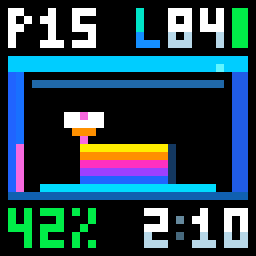
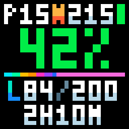
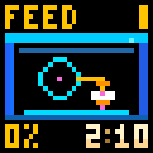
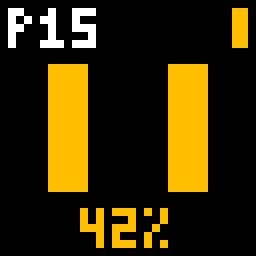
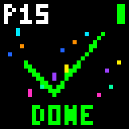
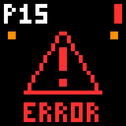
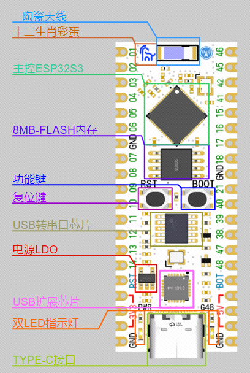
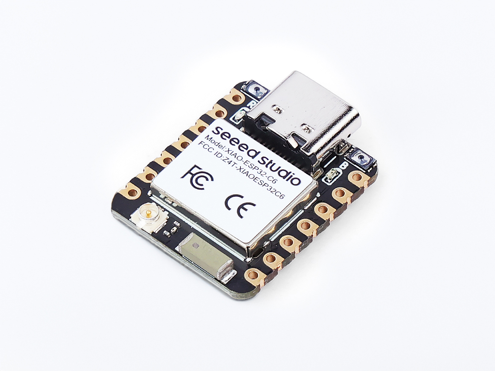
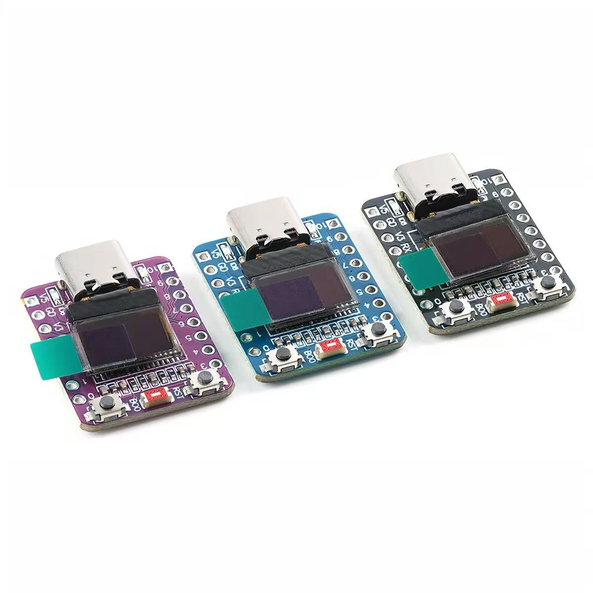

# iDotMatrix × Bambu Lab

[简体中文](README.md) · [English](README.en.md)

Keep your Bambu Lab print status in sight. An independent pixel-display controller for ESP32 boards.

A supported ESP32 board connects your Bambu Lab printer to an iDotMatrix 32×32 Bluetooth pixel display. Manage it from a phone or desktop browser, without a touchscreen or an always-on computer.

## Pixel animations

|  |  |  |
|:---:|:---:|:---:|
| **Colour printer**  | **Progress view**  | **Loading / unloading**  |
| **Paused**  | **Complete**  | **Error**  |

[View all 32×32 animations](docs/PIXEL_DISPLAYS.en.md)

## Web installer

**[Open the iDotMatrix × Bambu Lab web installer](https://tbc0309.github.io/xTouch-CN/idotmatrix.html?lang=en)**

Use Chrome or Edge on a computer and connect a supported board listed below with a USB data cable. Select your board and follow the installation prompts. After the first installation, connect to the board's Wi-Fi hotspot to configure Wi-Fi. Then open its local IP address and set a new admin password on first sign-in.

## Features

- **LAN and cloud connections**: LAN printers and Chinese or international Bambu Lab accounts, with Token, password, verification-code and two-factor support as required.
- **Multiple devices**: save printers and accounts, then select the printer to monitor. One active printer connection at a time.
- **Animated states**: preparation, heating, homing, leveling, nozzle cleaning, loading, calibration, checking, printing, filament changes, pause, completion, cancellation, errors and offline status. Specific stages follow the printer's actual reports.
- **Progress and filament colors**: yellow percentages before the first layer and green once printing begins. Model height follows layers; nozzle and loading animations follow filament color. Black filament uses a visible dark gray.
- **Printing layouts**: colorful printer or progress view during printing, with shared preparation, filament-change and result screens. Completed progress cycles through rainbow colors moving right; the remaining bar uses the filament color.
- **Display controls**: Bluetooth scanning or manual MAC entry, six-digit device password, brightness, display power and 180° rotation.
- **Independent idle clock**: the display's built-in clock keeps time after Bluetooth disconnects, using Windows timezones with automatic daylight-saving transitions.
- **Eight-language interface**: Simplified Chinese, Traditional Chinese, English, French, German, Russian, Japanese and Korean. Responsive layouts initialize language and timezone from the browser on first sign-in, then use saved settings.
- **Credential protection**: Wi-Fi setup without sign-in, mandatory password change on the first LAN login, optional device-bound encryption and unlocking before editing saved fields.
- **Network and maintenance**: Wi-Fi hotspot setup, configuration backup and restore, and dual-partition OTA. Startup update checks are on by default; installation requires confirmation. Manual application BIN uploads remain available.
- **BOOT reset**: hold for three seconds to clear Wi-Fi, or ten seconds to clear all settings.

This project displays printer status; it does not start prints or control movement or heating.

The ESP32-C3 OLED shows status and print progress in large text. While idle, it shows the time for 10 seconds, then a thin-stroke scrolling IP address for 5 seconds; a full address scroll takes about 1.8 seconds.

## Supported ESP32 development boards

| Board image | Development board | MCU and memory | Support | Reference price (CNY / USD) |
|---|---|---|---| --- |
|  | [LCKFB ESP32S3R8N8](https://wiki.lckfb.com/zh-hans/esp32s3r8n8/) | ESP32-S3 · 8 MB Flash · 8 MB PSRAM | Supported and hardware-tested | ¥35.90 / ≈US$5.38 |
|  | [Seeed Studio XIAO ESP32C6](https://wiki.seeedstudio.com/xiao_esp32c6_getting_started/) | ESP32-C6 · 4 MB Flash · 512 KB SRAM | Supported | ¥27.00 / ≈US$4.05 |
|  | [ESP32-C3 0.42 OLED](boards/esp32c3-oled-042/README.md) | ESP32-C3 · 4 MB Flash · 400 KB SRAM | Onboard OLED status and external pixel display | ¥14.80 / ≈US$2.22 |

Use a compatible iDotMatrix 32×32 Bluetooth display and 2.4 GHz Wi-Fi. Power the board and display separately; no signal wiring is required between them. See [third-party notices](THIRD-PARTY.md) for the board image source and license.

## 3D-printable enclosure

Enclosure files for the LCKFB ESP32S3R8N8 development board. Open them in Bambu Studio or another slicer that supports 3MF.

| Version | File |
|---|---|
| Cut-out logo | [lckfb-esp32s3r8n8.3mf](case/lckfb-esp32s3r8n8/lckfb-esp32s3r8n8.3mf) |
| Two-color logo | [lckfb-esp32s3r8n8-logo.3mf](case/lckfb-esp32s3r8n8/lckfb-esp32s3r8n8-logo.3mf) |

[Project](https://github.com/tbc0309/idotmatrix-bambulab) · [License](LICENSE) · [Third-party notices](THIRD-PARTY.md)
