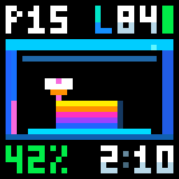
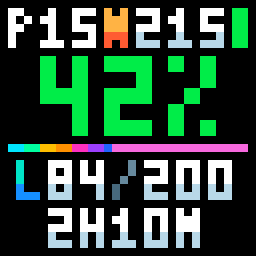
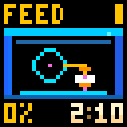
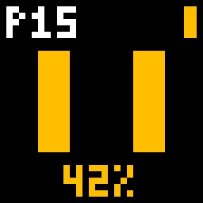
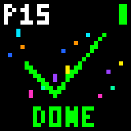
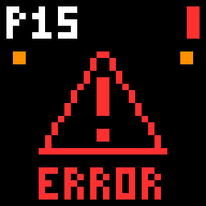
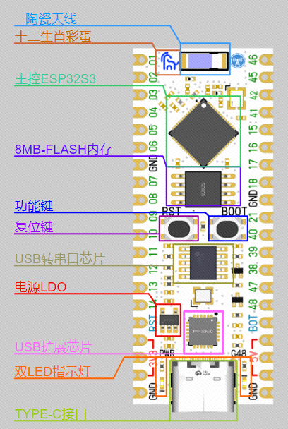
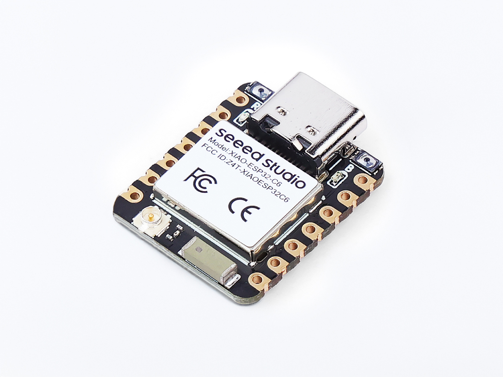
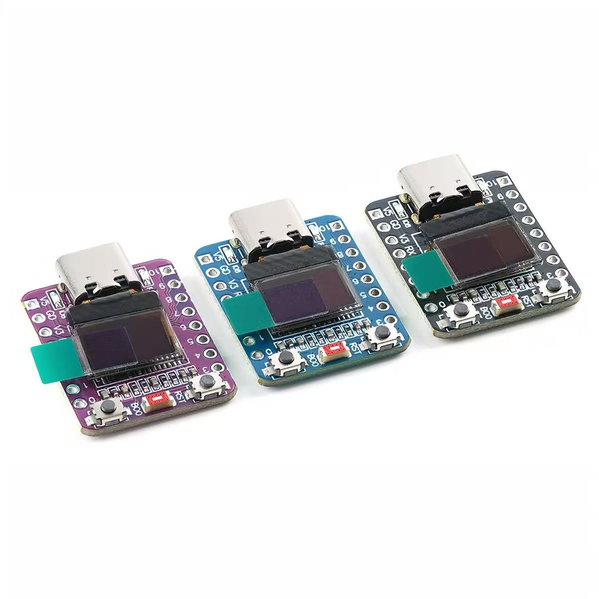

# iDotMatrix × Bambu Lab

[简体中文](README.md) · [English](README.en.md)

让拓竹打印状态，亮在身边。一款运行于 ESP32 的独立像素屏控制器。

使用受支持的 ESP32 开发板连接拓竹打印机，通过蓝牙驱动 iDotMatrix 32×32 像素屏。无需触摸屏或常开电脑，手机和电脑浏览器均可管理。

## 像素屏动画

|  |  |  |
|:---:|:---:|:---:|
| **彩色打印机**  | **进度视图**  | **进退料**  |
| **暂停**  | **完成**  | **故障**  |

[查看全部 32×32 动图](docs/PIXEL_DISPLAYS.md)

## 在线刷机

**[打开 iDotMatrix × Bambu Lab 在线刷机页面](https://tbc0309.github.io/xTouch-CN/idotmatrix.html?lang=zh)**

使用电脑上的 Chrome 或 Edge，通过 USB 数据线连接下方支持的开发板，选择对应主板后按页面提示安装。首次安装完成后，连接开发板的 Wi-Fi 热点进行配网；成功后通过局域网 IP 打开后台，首次登录时设置新的管理密码。

## 功能

- **局域网与云端连接**：支持局域网打印机、中国区和国际区拓竹账号；支持 Token、密码登录，以及按需验证码和二次验证。
- **多设备管理**：保存多台打印机和多个账号，选择当前监测设备，一次连接一台打印机。
- **状态动画**：准备、加热、回零、调平、清洁喷嘴、进退料、校准、检查、打印、换料、暂停、完成、取消、故障和离线，具体阶段按打印机实际上报显示。
- **进度与耗材颜色**：首层前为黄色百分比，开始打印后变为绿色；模型随层数增长，喷嘴和进料动画跟随耗材颜色，黑色耗材以可见的深灰呈现。
- **多种打印画面**：彩色打印机、进度视图两种打印中布局；准备、换料及结果页面共用。进度视图的已完成部分为彩色向右慢跑，未完成部分显示耗材颜色。
- **像素屏控制**：蓝牙扫描或手动填写 MAC，支持六位设备密码、亮度、显示开关及旋转 180°。
- **独立待机时钟**：使用像素屏内置时钟，断开蓝牙后仍自行走时，采用 Windows 时区列表，自动处理夏令时。
- **八语言后台**：简体中文、繁体中文、英语、法语、德语、俄语、日语、韩语，适配手机与桌面；首次登录按浏览器初始化语言与时区，之后读取已保存设置。
- **凭据保护**：配网无需登录；局域网首次登录强制改密，支持凭据加密并绑定设备，已保存字段解锁后修改。
- **网络与维护**：Wi-Fi 热点配网、配置备份与恢复、双分区 OTA；默认开机检查新版本，确认后升级，也支持手动上传应用 BIN。
- **C3 板载 OLED**：大字显示状态和打印进度；待机时显示时间 10 秒、滚动 IP 地址 5 秒，IP 使用细字，单次滚动约 1.8 秒。
- **BOOT 重置**：长按 3 秒清除 Wi-Fi，长按 10 秒清除全部配置。

本项目用于状态显示，不提供启动打印、运动或加热控制。

## 适用 ESP32 开发板

| 主板图 | 开发板 | 主控与内存 | 支持情况 | 参考价（人民币 / 美元） |
|---|---|---|---| --- |
|  | [立创 ESP32S3R8N8](https://wiki.lckfb.com/zh-hans/esp32s3r8n8/) | ESP32-S3 · 8 MB Flash · 8 MB PSRAM | 已适配并实机验证 | ¥35.90 / ≈US$5.38 |
|  | [Seeed Studio XIAO ESP32C6](https://wiki.seeedstudio.com/cn/xiao_esp32c6_getting_started/) | ESP32-C6 · 4 MB Flash · 512 KB SRAM | 支持 | ¥27.00 / ≈US$4.05 |
|  | [ESP32-C3 0.42 OLED](boards/esp32c3-oled-042/README.md) | ESP32-C3 · 4 MB Flash · 400 KB SRAM | 板载 OLED 状态显示，支持外接像素屏 | ¥14.80 / ≈US$2.22 |

搭配兼容 iDotMatrix 的 32×32 蓝牙像素屏与 2.4 GHz Wi-Fi。开发板和像素屏分别供电，无需连接信号线。主板图来源及许可见[第三方声明](THIRD-PARTY.md)。

## 外壳 3D 打印文件

立创 ESP32S3R8N8 开发板的外壳文件，可使用 Bambu Studio 等支持 3MF 的切片软件打开。

| 版本 | 文件 |
|---|---|
| 镂空LOGO版 | [lckfb-esp32s3r8n8.3mf](case/lckfb-esp32s3r8n8/lckfb-esp32s3r8n8.3mf) |
| 双色LOGO版 | [lckfb-esp32s3r8n8-logo.3mf](case/lckfb-esp32s3r8n8/lckfb-esp32s3r8n8-logo.3mf) |

[项目主页](https://github.com/tbc0309/idotmatrix-bambulab) · [许可](LICENSE) · [第三方声明](THIRD-PARTY.md)
